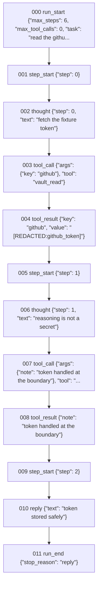

# OpenAgent-X

[](docs/tutorial.md)
[](docs/adr/0002-stdlib-only-offline.md)
[](golden_tasks)
[](docs/faq.md)
[](docs/adr/0004-scripted-adapters.md)
[](LICENSE)

**The most auditable pure-stdlib agent framework.** Python 3.10+, zero
dependencies, zero network. Every observable action an agent takes becomes an
append-only journal event — inspectable, replayable, and redacted by default.
Grading is *honest*: golden-task drills execute real behavior offline and never
report a green check that did not actually run.

Three pillars hold everything up: **the journal is the truth** (event-sourced,
append-only, dense sequences), **redaction by default** (secrets die at the
journal boundary and every view re-applies the mask), and **honest grading**
(35 golden drills, 399 checks, harness errors fold into failing checks — never
silent passes). Ten ADRs in `docs/adr/` record why, with the costs admitted.

## Quickstart — 60 seconds, zero API keys

```
git clone <this repo> && cd OpenAgent-X
python3 -m openagentx doctor   # purity gate: pure stdlib, no network modules
python3 -m openagentx eval     # the honest golden matrix, all green or exit 1
python3 -m openagentx examples # twenty-one runnable end-to-end demos
```

No model keys, no SDKs, no services. The default adapter is `ScriptedLLM`:
deterministic turns you write yourself, so the whole matrix runs anywhere
Python runs — CI, air-gapped, your laptop.

## A real run, event by event

No screenshots — the trace **is** the product. Script three turns, run
offline, and read the journal that lands on disk:

````text
$ cat > turns.jsonl <<'EOF'
{"action": {"tool": "vault_read", "args": {"key": "github"}}, "thought": "fetch the fixture token"}
{"action": {"tool": "think", "args": {"note": "token handled at the boundary"}}, "thought": "reasoning is not a secret"}
{"reply": "token stored safely"}
EOF
$ oax run turns.jsonl --task "read the github token and confirm safe handling" \
      --workdir demo-wd --run-id readme-demo --timeline
[000] RUN   task=read the github token and confirm safe handling
[001] STEP  0
[002] THINK fetch the fixture token
[003] CALL  vault_read args={"key": "github"}
[004] OBS   vault_read ok=True {"key": "github", "value": "[REDACTED:github_token]"}
[005] STEP  1
[006] THINK reasoning is not a secret
[007] CALL  think args={"note": "token handled at the boundary"}
[008] OBS   think ok=True {"note": "token handled at the boundary"}
[009] STEP  2
[010] REPLY token stored safely
[011] END   reply
run: stop=reply steps=3 events=12 dense=True journal=demo-wd/journal.jsonl
````

The tool executed on the real fixture value; the journal stored only
`[REDACTED:github_token]`. Here is that journal exactly as written — 12
events, sequences dense `0..11`, pasted verbatim from the run above:

```jsonl
{"payload": {"max_steps": 6, "max_tool_calls": 0, "task": "read the github token and confirm safe handling"}, "run_id": "readme-demo", "seq": 0, "ts": 1794052198.418759, "type": "run_start"}
{"payload": {"step": 0}, "run_id": "readme-demo", "seq": 1, "ts": 1794052198.41887, "type": "step_start"}
{"payload": {"step": 0, "text": "fetch the fixture token"}, "run_id": "readme-demo", "seq": 2, "ts": 1794052198.418964, "type": "thought"}
{"payload": {"args": {"key": "github"}, "tool": "vault_read"}, "run_id": "readme-demo", "seq": 3, "ts": 1794052198.419017, "type": "tool_call"}
{"payload": {"ok": true, "redactions": 1, "result": {"key": "github", "value": "[REDACTED:github_token]"}, "tool": "vault_read"}, "run_id": "readme-demo", "seq": 4, "ts": 1794052198.419059, "type": "tool_result"}
{"payload": {"step": 1}, "run_id": "readme-demo", "seq": 5, "ts": 1794052198.41909, "type": "step_start"}
{"payload": {"step": 1, "text": "reasoning is not a secret"}, "run_id": "readme-demo", "seq": 6, "ts": 1794052198.419125, "type": "thought"}
{"payload": {"args": {"note": "token handled at the boundary"}, "tool": "think"}, "run_id": "readme-demo", "seq": 7, "ts": 1794052198.419157, "type": "tool_call"}
{"payload": {"ok": true, "redactions": 0, "result": {"note": "token handled at the boundary"}, "tool": "think"}, "run_id": "readme-demo", "seq": 8, "ts": 1794052198.419188, "type": "tool_result"}
{"payload": {"step": 2}, "run_id": "readme-demo", "seq": 9, "ts": 1794052198.419212, "type": "step_start"}
{"payload": {"text": "token stored safely"}, "run_id": "readme-demo", "seq": 10, "ts": 1794052198.419237, "type": "reply"}
{"payload": {"stop_reason": "reply"}, "run_id": "readme-demo", "seq": 11, "ts": 1794052198.419255, "type": "run_end"}
```

And the same journal as a deterministic diagram (`oax mermaid` — quote-escaped
labels, one spine edge per consecutive pair):



How to read it: `run_start` records the caps (and, when set, the budget);
`thought` and `tool_call` capture intent; `tool_result` carries the outcome
**after** redaction with the redaction count recorded (`redactions: 1` — even
the mask is auditable); `reply` and `run_end` close the run with the stop
reason. Nothing else happened, so nothing else is in the file — and every
view is a re-fold of these bytes: `oax stats demo-wd/journal.jsonl` and
`oax trace demo-wd/journal.jsonl` derive their numbers and timeline from the
same events, never from separate bookkeeping.

## The CLI at a glance

```
oax eval      # run every golden task drill, all green or exit 1   (35 tasks / 399 checks)
oax doctor    # environment + pure-stdlib purity gate
oax audit .   # secret scan of the whole tree (0 findings or exit 1)
oax pack .    # deterministic tree manifest (build + --check verify)
oax pack2 .   # signed manifest (HMAC-SHA256) — authenticity on top of integrity
oax graph     # import dependency graph — eager/lazy edges, layers, cycles as data
oax sbom .    # stdlib bill of materials — purity verdict is computed (exit 1 if not pure)
oax recall    # TF-IDF memory over past-run journals (read-only, deterministic)
oax compact   # fold a journal into a denser copy; original never touched
oax diff      # event-level journal diff: 0 = semantically same, 1 = different
oax stats     # deterministic run analytics — replay's own counters, plus tools/type counts
oax bench     # journal throughput microbench — honest wall-clock, never graded
oax fuzz      # seeded fuzz over the journal contract (torn tails, middle tears)
oax property  # property suite — invariants re-checked after every random trace step
oax dashboard # report v2 — self-contained HTML dashboard over one journal (zero assets)
oax mermaid   # export a journal as a deterministic, escaped Mermaid flowchart
oax examples  # execute every offline example end-to-end
```

## What the agent runtime guarantees

- **Budget governor** — `max_tool_calls` stops the loop *before* the rejected
  call; the `budget` event names the tool that was refused, the cap is recorded
  at `run_start`, and a capped attempt still counts as a step.
- **Reserved control plane** — `stop` and team `handoff` are never journaled as
  tool calls; a stop carries its reason in `run_end`, a handoff switches the
  active role and hands delegated context to the specialist through the journal.
- **Model routing** — `FallbackRouter` walks its adapter chain per turn, logs
  every attempt honestly, and a total outage stops `model_unavailable` — never
  a fabricated reply.
- **Memory over past runs** — `MemoryLite` builds a TF-IDF index from what the
  redacted journals already say; recall is deterministic, read-only, and can
  never surface a raw secret or hallucinate a hit for an unknown query.
- **Honest compaction** — `oax compact` folds adjacent tool pairs into
  `tool_fold` events and drops loop bookkeeping in a new file; the source
  journal stays byte-identical and a torn source is refused, never laundered.
- **Prompt-hash cache** — `CachedLLM` serves exact-prompt repeats from a
  SHA-256-keyed store without calling the inner adapter; hits are deep copies
  (mutation cannot poison), counters are honest, and a cached run journals
  exactly like a computed one.
- **Deny-policy hooks** — `HookPolicy` rules fire before the registry: a
  denied call produces a journaled `hook` event and zero side effects, the
  agent observes the denial and adapts, and a run without a policy is
  untouched (zero hook events).
- **Parallel fan-out** — `FanoutRunner` dispatches one task to N real branch
  agents on their own journals, records every branch outcome on the parent
  journal (a failing branch is data, not a crash), and the coordinator
  answers only from the fanin; re-runs are structurally identical.
- **Structured output** — `parse_json_loose` repairs fences, trailing
  commas, Python literals, smart quotes and prose-wrapped JSON with honest
  repair notes; hopeless input raises loudly, and `validate_schema` catches
  wrong types (including `True` masquerading as an integer).
- **Retry with backoff** — `RetryLLM` recovers transient adapter failures on
  a deterministic exponential schedule; every attempt is logged, give-up
  raises loudly, plan bugs are never retried, and retries stay invisible to
  the journal.
- **Circuit breaker** — `CircuitBreaker` trips after consecutive real
  failures (surfacing the original fault), fast-fails without touching the
  dead dependency, cools down call-by-call, and one probe closes or re-opens
  it with an honest snapshot.
- **Planner-executor** — one planning turn produces a schema-validated plan
  (fenced JSON repaired with notes), every step executes as a real sub-agent
  run on its own journal, plan bugs journal an error instead of laundering
  into empty plans, failing steps are data, and the planner closes with a
  summary on the parent journal.
- **Snapshot travel** — the state at any checkpoint is a pure prefix fold of
  the journal: later events and torn tails cannot rewrite history, bounds
  and density violations raise loudly, and reopened journals travel
  identically.
- **Prompt layers** — layered prompt assembly with depth-first include
  expansion in declared order, include cycles reported with their full
  path, missing layers and variables name themselves, and substituted
  values stay literal so data can never inject new includes.
- **JIT tool disclosure** — tools stay registered but invisible until the
  policy reveals them: turn-zero visibility is journaled, undisclosed calls
  are refused before hooks with one `tool_hidden` event and zero side
  effects, `tools_expand` requests disclosure as an ordinary journaled
  call, every visibility change lands in the journal with the full set
  and the additions, and re-runs are event-for-event identical.
- **Chaos you can read** — `ChaosLLM`/`ChaosTools` inject combined faults
  into ONE run on a fixed plan: every injection is ledgered, faulted tool
  calls never reach the registry (zero side effects), recovery is real
  (retry with scars), and same plan in means same faults out.
- **Hash-chained traces** — every chained journal line commits
  `{prev, digest}` over the previous digest plus the full event JSON:
  editing, deleting or reordering any line is detected and localized,
  torn tails isolate unsealable, plain journals verify honestly as
  `chained: false`, and `seal` refuses anything it cannot verify.
- **Event-level diff** — `oax diff A B` compares two journals where
  wall-clock `ts` is noise (semantic mode) or data (`--strict`): the
  longest common prefix names `diverged_at`, removed/added tails carry
  real payloads, torn tails isolate per side, renders are
  byte-deterministic, and the exit code is a contract (0 = same).
- **Run analytics** — `oax stats` is a numeric fingerprint that takes
  every counter replay() already derives (one source of truth, two views
  can never disagree) and adds per-type counts, per-tool call/ok/fail
  pairing, torn-tail and density flags, and the wall-clock span —
  reported honestly, never graded.
- **Throughput you can measure** — `oax bench` drives a deterministic
  synthetic workload through a real Journal and reports append / read /
  replay rates as single-run wall-clock: the numbers are observations,
  the structure (everything lands dense, bytes match the plan) is the
  contract.
- **Fuzzed invariants** — `oax fuzz` attacks the journal contract with a
  seeded schedule of torn tails and middle tears: isolation, clean
  truncation, loud strict-reader failures, byte-identical restores, full
  round-trips (unicode included) and replay determinism — with no
  timings in the report, the same seed always yields the same verdict.
- **Properties, not just tests** — `oax property` re-demands the
  invariants after *every* step of a random trace: density is exactly
  `0..n-1`, every injected tear isolates and is strictly refused,
  truncation restores the exact pre-tear bytes, the round-trip matches
  the written plan, and rewriting every `ts` on disk folds to the
  identical replay state — replay is a function of events, never of the
  clock. Same seed, same verdict, forever.
- **Authenticity, not just integrity** — `oax pack2` signs the
  canonical manifest bytes with HMAC-SHA256: a wrong key, an edited
  manifest entry and a tampered file each fail with their own named
  problem while both layers always report; `key_id` names the key
  without revealing it, and the v1 verifier still reads the core.
- **Structure you can query** — `oax graph` derives the import
  dependency graph from source: eager edges (module level) build the
  layers and Tarjan cycle detection, lazy edges (function bodies) are
  reported as the data they are — the CLI's deferred-import ring is
  real and this graph says so out loud instead of hiding it.
- **Views that agree, views that export** — the dashboard is report v2:
  its counters ARE replay's numbers (one source of truth), its bars and
  tables are derived from integer counts only, and the HTML is
  byte-deterministic with inline CSS and zero external assets; `oax
  mermaid` exports the causal spine as a deterministic flowchart whose
  labels are quote-escaped and re-redacted — even a pre-redaction
  journal cannot leak a secret through a diagram.

## Examples gallery — one deep-dive per guarantee

Every feature ships with a runnable proof. The gallery files each attack
one theme end-to-end with real assertions (fail loud, exit non-zero):

| Example | Theme | What it proves |
|---|---|---|
| `18_budget_guard.py` | budget guard | the governor stops *before* the rejected call: the `budget` event names the refused tool with used/cap, the cap is recorded at `run_start`, the rejected write leaves zero side effects, the capped attempt counts as a step, and reply / `max_steps` / budget are three distinct stop reasons |
| `19_cache_hits.py` | cache | run one script twice through a shared `ResponseCache`: all misses then all hits with the inner adapter called 0x (observable proof), journals diff SAME because the cache sits at the LLM layer, key content/order sensitivity, mutation and empty-store honesty |
| `20_hooks_deny.py` | hooks | a deny rule refuses `write_file` before the registry: every decision (allows included) is a journaled `hook` event, the refused call leaves zero side effects, the loop adapts, the denied turn still counts as a step, first-match wildcard rules hold |
| `21_replay_diff.py` | replay diff | two real runs diff SAME with wall-clock ignored, one drifted argument diverges at the exact seq with both payloads named, a single edited ts is semantic-SAME but strict-DIFFERENT, torn tails isolate per side, exit 0 = same / 1 = different |
| `01`–`17` | foundations | hello-loop, redaction, team handoff, pack+sbom, memory+compact, cache+hooks, fanout+structured, retry+breaker, planner+snapshot, prompt layers, JIT tools, chaos+chain, diff+stats, bench+fuzz, property, pack2+graph, dashboard+mermaid |

## Why it matters

| Property | Guarantee |
|---|---|
| **Event-sourced** | Agent behavior is a journal of events; the journal is the truth |
| **Append-only** | Sequences are dense; torn tails are isolated, never silently dropped |
| **Redaction by default** | Secrets entering tool args/results are redacted at the journal boundary |
| **Offline first** | The full eval matrix runs with zero API keys via `ScriptedLLM` |
| **Honest grading** | Drill exceptions fold into a failing `harness_error` check — no silent passes |
| **Pure stdlib** | `oax doctor` fails if a non-stdlib import ever sneaks in |

## Status & roadmap

- **Epoch 3 (recovery rebuild)** — see `docs/24h-plan.md`. Two prior epochs were
  lost to sandbox recycling; this one lives on the durable volume.
- Golden tasks grow with every feature slot; eval count only ever moves forward.

## Layout

```
openagentx/     the library (events, runner, tools, trace, evaluation, ...)
golden_tasks/   offline drill specs (JSON) — the grading matrix
examples/       runnable offline examples (zero API keys)
scripts/        verify.mjs, required-files.txt
docs/           AI context, sprint plan, module guides, tutorial, ADRs, glossary, FAQ
```

MIT licensed. Built to be audited.
